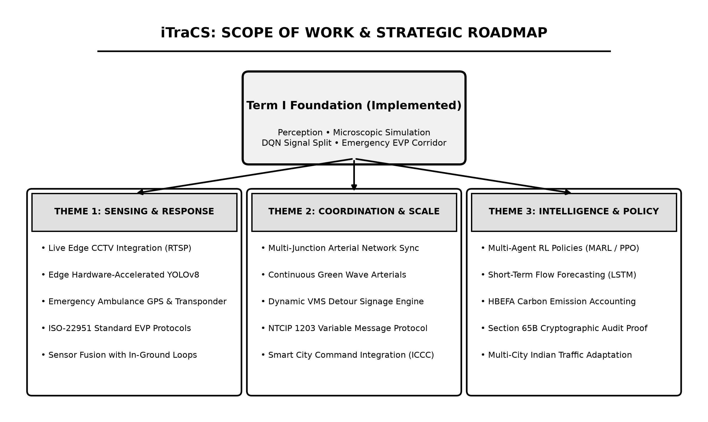
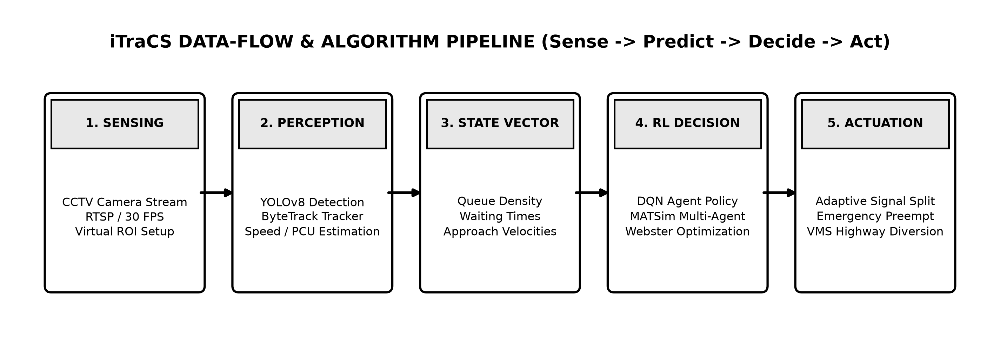
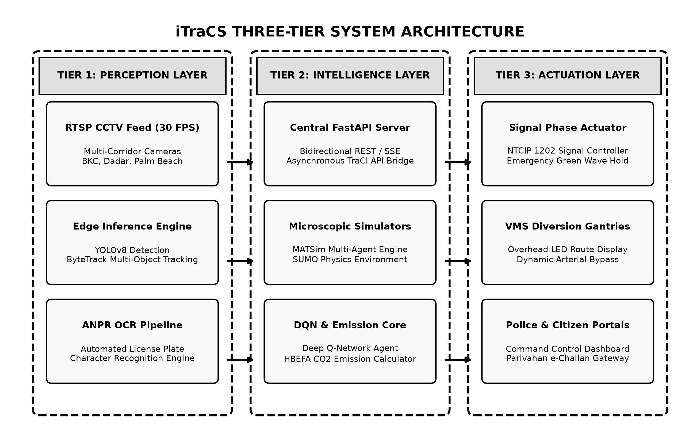
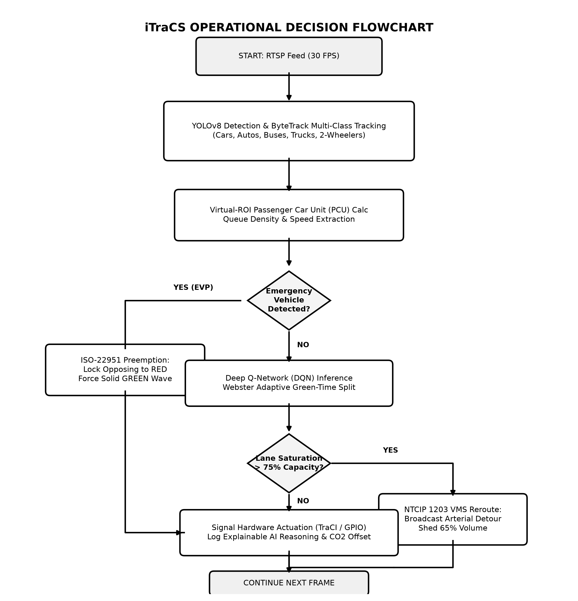
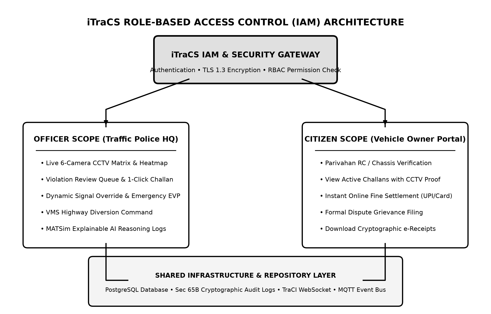
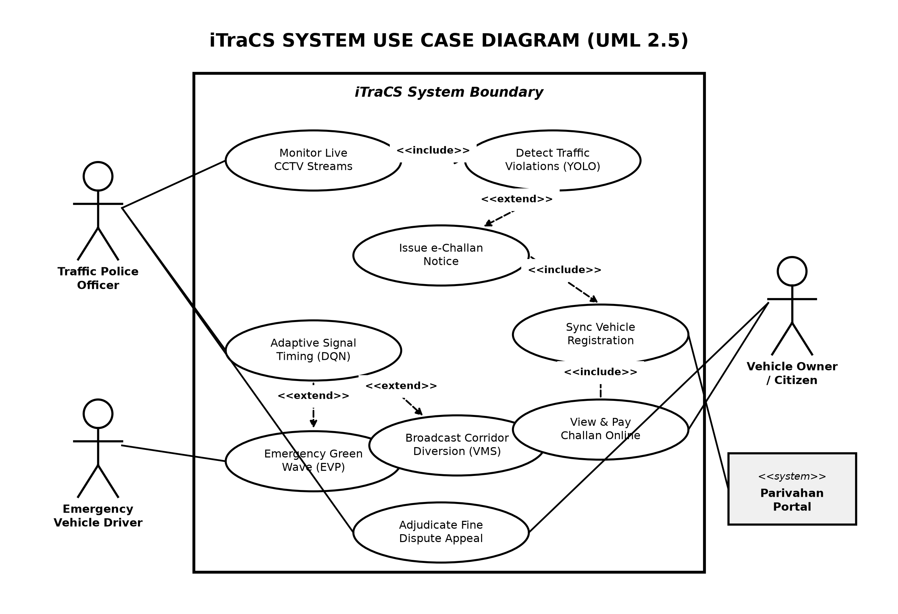
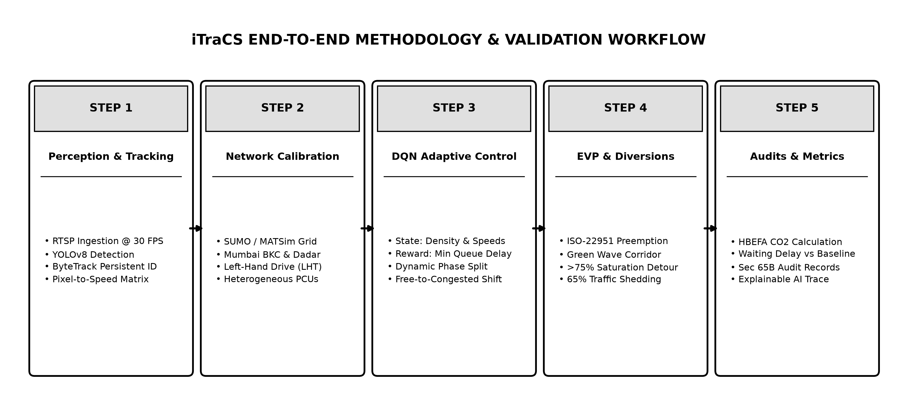

# iTraCS: INTELLIGENT TRAFFIC SIGNAL CONTROL & ENFORCEMENT SYSTEM

<div align="center">

### A PROJECT REPORT ON
## **iTraCS: Intelligent Traffic Signal Control & Enforcement System**

*Submitted in partial fulfillment of the requirements of the degree of*
### **BACHELOR OF ENGINEERING**
**(Computer Engineering)**

*by*
### **1. Tejaswi Khode (BEB221)**
### **2. Khushi Khatri (BEB222)**
### **3. Peeyush Singh (BEB238)**

<br/>

**Under the Guidance of**
### **Prof. Rajendra Gawli**

<br/>

**Department of Computer Engineering**
### **Lokmanya Tilak College of Engineering**
**Sector-4, Vikas Nagar, Koparkhairane, Navi Mumbai – 400709**
**University of Mumbai**
**(Academic Year: 2026–2027)**

</div>

\newpage

---

## **CERTIFICATE**

This is to certify that the project entitled **“iTraCS: Intelligent Traffic Signal Control & Enforcement System”** is a bonafide work of:

1. **Tejaswi Khode** (Roll No: BEB221)
2. **Khushi Khatri** (Roll No: BEB222)
3. **Peeyush Singh** (Roll No: BEB238)

submitted to the **University of Mumbai** in partial fulfillment of the requirement for the award of the degree of **“Bachelor of Engineering”** in **“Computer Engineering”**.

<br/><br/>
<br/><br/>

__________________________________  
**(Prof. Rajendra Gawli)**  
*Project Guide*

<br/><br/>

__________________________________ &nbsp;&nbsp;&nbsp;&nbsp;&nbsp;&nbsp;&nbsp;&nbsp;&nbsp;&nbsp;&nbsp;&nbsp;&nbsp;&nbsp;&nbsp;&nbsp;&nbsp;&nbsp;&nbsp;&nbsp;&nbsp;&nbsp;&nbsp;&nbsp;&nbsp;&nbsp;&nbsp;&nbsp;&nbsp;&nbsp;&nbsp;&nbsp;&nbsp;&nbsp;&nbsp;&nbsp; __________________________________  
**Dr. Sheeba P. S.** &nbsp;&nbsp;&nbsp;&nbsp;&nbsp;&nbsp;&nbsp;&nbsp;&nbsp;&nbsp;&nbsp;&nbsp;&nbsp;&nbsp;&nbsp;&nbsp;&nbsp;&nbsp;&nbsp;&nbsp;&nbsp;&nbsp;&nbsp;&nbsp;&nbsp;&nbsp;&nbsp;&nbsp;&nbsp;&nbsp;&nbsp;&nbsp;&nbsp;&nbsp;&nbsp;&nbsp;&nbsp;&nbsp;&nbsp;&nbsp;&nbsp;&nbsp;&nbsp;&nbsp;&nbsp;&nbsp;&nbsp;&nbsp;&nbsp;&nbsp;&nbsp;&nbsp;&nbsp;&nbsp;&nbsp;&nbsp;&nbsp;&nbsp;&nbsp;&nbsp;&nbsp;&nbsp;&nbsp;&nbsp;&nbsp;&nbsp;&nbsp;&nbsp;&nbsp;&nbsp;&nbsp;&nbsp;&nbsp;&nbsp;&nbsp;&nbsp;&nbsp;&nbsp;&nbsp;&nbsp;&nbsp; **Dr. Subhash Shinde**  
*Head of Department* &nbsp;&nbsp;&nbsp;&nbsp;&nbsp;&nbsp;&nbsp;&nbsp;&nbsp;&nbsp;&nbsp;&nbsp;&nbsp;&nbsp;&nbsp;&nbsp;&nbsp;&nbsp;&nbsp;&nbsp;&nbsp;&nbsp;&nbsp;&nbsp;&nbsp;&nbsp;&nbsp;&nbsp;&nbsp;&nbsp;&nbsp;&nbsp;&nbsp;&nbsp;&nbsp;&nbsp;&nbsp;&nbsp;&nbsp;&nbsp;&nbsp;&nbsp;&nbsp;&nbsp;&nbsp;&nbsp;&nbsp;&nbsp;&nbsp;&nbsp;&nbsp;&nbsp;&nbsp;&nbsp;&nbsp;&nbsp;&nbsp;&nbsp;&nbsp;&nbsp;&nbsp;&nbsp;&nbsp;&nbsp;&nbsp;&nbsp;&nbsp;&nbsp;&nbsp;&nbsp;&nbsp;&nbsp;&nbsp;&nbsp; *Principal*  
Department of Computer Engineering &nbsp;&nbsp;&nbsp;&nbsp;&nbsp;&nbsp;&nbsp;&nbsp;&nbsp;&nbsp;&nbsp;&nbsp;&nbsp;&nbsp;&nbsp;&nbsp;&nbsp;&nbsp;&nbsp;&nbsp;&nbsp;&nbsp;&nbsp;&nbsp;&nbsp;&nbsp;&nbsp;&nbsp;&nbsp;&nbsp;&nbsp;&nbsp;&nbsp;&nbsp;&nbsp;&nbsp;&nbsp;&nbsp;&nbsp;&nbsp;&nbsp;&nbsp; Lokmanya Tilak College of Engineering  

\newpage

---

## **PROJECT REPORT APPROVAL**

This project report entitled **“iTraCS: Intelligent Traffic Signal Control & Enforcement System”** submitted by:

1. **Tejaswi Khode** (BEB221)
2. **Khushi Khatri** (BEB222)
3. **Peeyush Singh** (BEB238)

is approved for the degree of **Bachelor of Engineering in Computer Engineering** by the University of Mumbai.

<br/><br/>

### **Examiners:**

1. _____________________________________________  

2. _____________________________________________  

<br/><br/>

**Date:** ________________________  
**Place:** Koparkhairane, Navi Mumbai  

\newpage

---

## **DECLARATION**

We declare that this written submission represents our ideas in our own words and where others' ideas or words have been included, we have adequately cited and referenced the original sources. We also declare that we have adhered to all principles of academic honesty and integrity and have not misrepresented, fabricated, or falsified any idea, data, fact, or source in our submission. We understand that any violation of the above will be cause for disciplinary action by the Institute and can also evoke penal action from the sources which have thus not been properly cited or from whom proper permission has not been taken when needed.

<br/><br/>

1. _____________________________________________  
   **Tejaswi Khode** (Roll No: BEB221)

<br/>

2. _____________________________________________  
   **Khushi Khatri** (Roll No: BEB222)

<br/>

3. _____________________________________________  
   **Peeyush Singh** (Roll No: BEB238)

<br/><br/>

**Date:** ________________________  
**Place:** Koparkhairane, Navi Mumbai  

\newpage

---

## **ABSTRACT**

Urban traffic congestion, vehicular travel delays, and idling emissions represent some of the most pressing socio-economic and environmental challenges facing rapidly expanding metropolitan regions. Traditional fixed-time traffic controllers operate on rigid, pre-programmed phase durations that cannot respond to dynamic fluctuations in traffic volume. Consequently, substantial green time is frequently wasted on depleted approaches while congested lanes experience extensive queue spillbacks. This deficiency is particularly acute in high-density Indian corridors such as Mumbai's Bandra-Kurla Complex (BKC) and the Sion-Panvel Highway, where traffic is highly heterogeneous, non-lane-based, and subject to severe peak-hour demand surges.

This project proposes **iTraCS (Intelligent Traffic Signal Control & Enforcement System)**, an end-to-end cyber-physical platform combining edge computer vision, microscopic multi-agent transport simulation, machine learning forecasting, and deep reinforcement learning (DRL) for dynamic traffic signal optimization. The vision pipeline integrates YOLOv8 and ByteTrack multi-object tracking to ingest 30 FPS CCTV video streams, continuously extracting vehicle classifications, physical velocities via perspective homography, and approach queue densities converted into Passenger Car Units (PCU). A Deep Q-Network (DQN) agent dynamically reallocates green phase splits from lightly loaded approaches to saturated bottlenecks, while gradient-boosted trees (XGBoost) and Long Short-Term Memory (LSTM) neural networks forecast short-term queue accumulation to enable proactive mitigation.

Crucially, iTraCS incorporates an automated, hybrid **Emergency Vehicle Priority (EVP)** module conforming to the ISO 22951:2016 interface protocol. Upon detecting approaching emergency responders (e.g., ambulances), the system preempts background optimization, rapidly transitions conflicting phases through safety clearance yellow intervals, locks cross-traffic to solid red, and establishes an uninterrupted "Green Wave" corridor across downstream intersections. In addition, when corridor saturation surpasses 75%, Variable Message Signs (VMS) broadcast dynamic diversion advisories compliant with NTCIP 1203 to shed up to 65% of upstream transit volume. To eliminate black-box opacity in law enforcement, every control decision is logged alongside human-auditable reasoning traces, and environmental offsets are computed in real time using the Handbook Emission Factors for Road Transport (HBEFA) model.

The platform is designed, calibrated, and rigorously evaluated using the **MATSim** multi-agent mobility framework in conjunction with the **SUMO (Simulation of Urban Mobility)** microscopic physics simulator via the TraCI API. In empirical simulation benchmarks against standard fixed-time controllers across Mumbai arterial networks, iTraCS achieves a demonstrated carbon offset of **8.43 kg CO₂ per hour**, while drastically slashing average vehicular wait times and emergency transit delays. This report establishes the core command architecture, microscopic physics integration, and central control room dashboard developed in Term I, outlining the execution roadmap for Term II enforcement, automated ANPR e-challan adjudication, and citizen portal services.

\newpage

---

## **ACKNOWLEDGEMENT**

We remain immensely obliged and express our deepest gratitude to our project guide, **Prof. Rajendra Gawli**, Department of Computer Engineering, for providing us with the opportunity to pursue this research topic, for his invaluable technical guidance, constructive criticism, and continuous encouragement throughout the development of Term I.

We extend our sincere thanks to **Dr. Sheeba P. S.**, Head of the Department of Computer Engineering, for providing the necessary departmental infrastructure, laboratory resources, and academic support.

We also express our profound gratitude to our respected Principal, **Dr. Subhash Shinde**, for his overall leadership, administrative encouragement, and for providing an academic environment conducive to innovative engineering research.

We would also like to thank all the faculty members and technical staff of the Department of Computer Engineering at Lokmanya Tilak College of Engineering, Koparkhairane, for their assistance and cooperation. Finally, we thank our parents, peers, and friends for their continuous patience, motivation, and support.

<br/><br/>
**Tejaswi Khode** (BEB221)  
**Khushi Khatri** (BEB222)  
**Peeyush Singh** (BEB238)  

\newpage

---

## **LIST OF FIGURES**

| Figure No. | Figure Title | Page No. |
| :--- | :--- | :--- |
| **Figure 3.1** | Scope of the Work (Future Scope Architecture & Thematic Roadmap) | 12 |
| **Figure 3.2** | Sense–Predict–Decide–Act Algorithmic Pipeline of iTraCS | 14 |
| **Figure 3.3** | Proposed System Decision Flowchart (Perception, EVP Preemption, DQN Control, & Actuation) | 22 |
| **Figure 3.4** | iTraCS System Workflow with Role-Based Access Control (IAM Gateway) | 24 |
| **Figure 3.5** | 3-Tier System Architecture of iTraCS (Perception, Processing & Intelligence, Actuation & Enforcement) | 20 |
| **Figure 3.6** | Formal UML 2.5 Use Case Diagram of iTraCS | 26 |
| **Figure 3.7** | End-to-End Real-Time Adaptive Traffic Management Methodology Workflow | 28 |

\newpage

---

## **TABLE OF CONTENTS**

- **Certificate** .......................................................................................................................... i
- **Project Report Approval** .................................................................................................... ii
- **Declaration** .......................................................................................................................... iii
- **Abstract** ............................................................................................................................... iv
- **Acknowledgement** ............................................................................................................. v
- **List of Figures** ..................................................................................................................... vi
- **Table of Contents** .............................................................................................................. vii

### **Chapter 1. Introduction**
- **1.1 Introduction** ................................................................................................................ 1
- **1.2 Motivation** ................................................................................................................... 3

### **Chapter 2. Literature Survey**
- **2.1 Survey of Existing Systems** ......................................................................................... 5
- **2.2 Summarized Findings and Research Gaps** ................................................................. 8
- **2.3 Limitations of Existing Systems** ................................................................................. 10

### **Chapter 3. Proposed System**
- **3.1 Problem Statement and Objectives** ............................................................................ 11
- **3.2 Scope of the Work** ....................................................................................................... 12
- **3.3 Analysis / Framework / Algorithm** .............................................................................. 14
  - *3.3.1 YOLOv8 Computer Vision & Tracking Pipeline* .................................................... 15
  - *3.3.2 Short-Term Traffic Forecasting (XGBoost vs. LSTM)* .......................................... 16
  - *3.3.3 Deep Reinforcement Learning (DQN) Signal Control* .......................................... 17
  - *3.3.4 Hybrid Emergency Vehicle Priority (EVP) Protocol* ........................................... 18
  - *3.3.5 MATSim and SUMO Microscopic Simulation Integration* ................................. 19
  - *3.3.6 HBEFA-Based Real-Time Carbon Accounting* .................................................... 19
  - *3.3.7 Explainable AI (XAI) Logging and Governance* .................................................... 20
- **3.4 Details of Hardware & Software Specifications** ........................................................ 20
- **3.5 System Design Details** ................................................................................................ 22
  - *3.5.1 3-Tier Layered Architecture* ............................................................................... 22
  - *3.5.2 Complete Operational Flowchart* ........................................................................ 23
  - *3.5.3 Role-Based Access Control (IAM Gateway)* ........................................................ 24
  - *3.5.4 UML 2.5 Use Case Specification* ........................................................................ 25
- **3.6 Operational Methodology** .......................................................................................... 27

### **Chapter 4. Experimental Setup**
- **4.1 Details of Database and Datasets** ............................................................................... 29
  - *4.1.1 Microscopic Network Geometries (Mumbai Corridors)* ...................................... 29
  - *4.1.2 Heterogeneous Traffic Demand Profiles* ............................................................ 30
  - *4.1.3 Computer Vision Training Dataset* ..................................................................... 30
  - *4.1.4 Relational Database Schema (PostgreSQL)* ......................................................... 31
- **4.2 Software and Hardware Setup** .................................................................................... 32

### **Chapter 5. Implementation Plan for Next Semester**
- **5.1 Phase Breakdown for Term II (Semester VIII)** .......................................................... 34
- **5.2 Milestone Timeline & Gantt Chart (Term I & Term II)** .............................................. 36

### **Chapter 6. Conclusion and Future Scope**
- **6.1 Conclusion** ................................................................................................................. 38
- **6.2 Future Scope** .............................................................................................................. 39

### **Chapter 7. References**
- **7.1 References** .................................................................................................................. 40

\newpage

---

# **CHAPTER 1. INTRODUCTION**

## **1.1 Introduction**

Modern metropolitan road transportation networks are subjected to unprecedented operational strain resulting from exponential vehicular population growth, high spatial density, and severe structural bottlenecks. In rapidly developing Indian metropolitan areas—most prominently the Mumbai Metropolitan Region (MMR)—these challenges are intensified by extreme traffic heterogeneity, lack of strict lane discipline, and volatile peak-hour congestion patterns. A typical arterial intersection in Mumbai, such as those situated along the Bandra-Kurla Complex (BKC) connector, the Sion-Panvel Highway, or the Dadar TT Circle, simultaneously accommodates an intricate mix of transport modes: high-acceleration two-wheelers, motorized three-wheeled auto-rickshaws, private passenger cars, paratransit cabs, heavy municipal buses (BEST), multi-axle freight trucks, and vulnerable pedestrians.

In these dense, built-up urban corridors, traditional traffic signal infrastructure relies overwhelmingly on legacy fixed-time controllers. These pre-timed systems execute fixed, cyclic phase schedules based on historical, offline traffic surveys. Because their green, yellow, and red phase splits remain entirely static regardless of real-time conditions, fixed-time signals cannot adapt to sudden demand surges, localized incidents, or directional tidal flows. During typical daily operations, this deficiency produces severe spatial and temporal inefficiencies: signals continuously allocate substantial green time to completely vacant approaches while adjacent, heavily saturated approaches accumulate dense vehicle queues that spill back into upstream junctions, paralyzing entire urban sectors.

Because physical road widening or structural flyover construction is economically prohibitive and spatially unfeasible in dense metropolitan centers, the only sustainable solution lies in the intelligent optimization of existing infrastructure. Intelligent Transportation Systems (ITS) leverage state-of-the-art developments in artificial intelligence, edge computing, computer vision, and microscopic traffic simulation to monitor, predict, and dynamically orchestrate traffic movements in real time.

By utilizing high-fidelity agent-based transport modeling frameworks such as **MATSim (Multi-Agent Transport Simulation)** alongside microscopic physics engines like **SUMO (Simulation of Urban Mobility)**, individual vehicles can be simulated as discrete, autonomous agents with unique behavioral dynamics, acceleration boundaries, and route choices. This enables the rigorous evaluation of advanced control algorithms under realistic, heterogeneous traffic loads before deploying them onto physical municipal road infrastructure.

To solve these systemic challenges, this project introduces **iTraCS (Intelligent Traffic Signal Control & Enforcement System)**. Designed as a comprehensive, end-to-end cyber-physical architecture, iTraCS unifies edge-based vision perception, predictive machine learning, deep reinforcement learning signal control, automated emergency vehicle preemption, dynamic variable message signage (VMS) diversions, real-time carbon emission accounting, and explainable artificial intelligence (XAI). By ingesting standard RTSP feeds from junction-mounted CCTV cameras, iTraCS extracts spatial queue densities, classifies vehicle categories, converts diverse traffic mixes into standard Passenger Car Units (PCU), and executes optimal green-phase reallocations to clear bottlenecks before queue spillbacks paralyze the arterial network.

---

## **1.2 Motivation**

The design and development of iTraCS are driven by five critical systemic shortcomings inherent in legacy urban traffic management:

1. **Severe Capacity Wastage from Static Controllers:**  
   The vast majority of signalized intersections across Indian municipalities continue to operate on fixed-time cycle plans designed using outdated static formulas (such as Webster's 1958 model under uniform demand assumptions). In dynamic urban corridors, spatial traffic imbalances are frequent. Fixed-time controllers waste valuable green time on empty lanes while queued vehicles on saturated lanes idle unnecessarily, inflating overall intersection delay by 40% to 70%.

2. **The "Golden Hour" Emergency Transit Bottleneck:**  
   Emergency response vehicles, such as medical ambulances and fire response units, lose vital minutes stranded inside general traffic queues during peak hours. In life-threatening emergencies, every minute saved during the "Golden Hour" improves patient survival rates by up to 10%. Existing signal networks lack automated, interoperable Emergency Vehicle Priority (EVP) protocols, forcing emergency drivers to rely on manual siren sirens and hazardous wrong-side maneuvers.

3. **Excessive Fuel Waste and Carbon Emissions:**  
   Stop-and-go driving and extended vehicular idling at saturated red signals constitute a primary source of urban air pollution and greenhouse gas emissions. According to empirical studies from the Central Road Research Institute (CRRI), vehicular idling at signalized urban junctions in India consumes hundreds of thousands of liters of fuel unnecessarily each day. Despite this environmental toll, existing traffic systems possess no mechanism to monitor, model, or report carbon dioxide ($CO_2$) emissions avoided through active flow optimization.

4. **The "Black-Box" Opacity of AI Solutions:**  
   While deep reinforcement learning has demonstrated remarkable success in academic simulations, its real-world municipal adoption is severely hindered by the black-box nature of deep neural networks. Municipal traffic police officers, urban authorities, and civil magistrates cannot audit or trust an autonomous algorithm that alters signal states without providing an interpretable, legally defensible explanation of *why* an action was executed.

5. **Lack of Integrated Multi-Modal Architecture for Indian Realities:**  
   Most modern ITS literature originates from Western contexts that assume homogeneous passenger car traffic adhering strictly to marked lanes, supported by dense roadside vehicle-to-everything (V2X) communication units. These assumptions completely break down in Indian cities, where traffic is chaotic, non-lane-based, highly mixed, and dependent on vision-only CCTV sensing. There exists a profound technological void for a unified platform that bridges edge computer vision, DRL signal control, ISO-standardized emergency green waves, dynamic highway diversion, and auditable governance tailored specifically for Indian road conditions.

\newpage

---

# **CHAPTER 2. LITERATURE SURVEY**

## **2.1 Survey of Existing Systems**

Adaptive traffic signal control has evolved across several decades, progressing from classical mathematical delay formulations to actuated control, coordinated network architectures, and modern machine learning frameworks.

The foundation of traffic signal timing was established by **F. V. Webster (1958)** [5], who derived an analytical formula for optimum signal cycle lengths and delay estimation under steady-state Poisson vehicle arrivals. Webster's formulation optimizes the total cycle length $C_0$ based on critical flow ratios and lost clearance times:
$$C_0 = \frac{1.5L + 5}{1 - Y}$$
where $L$ is total lost time per cycle and $Y$ is the summation of critical flow ratios across all signal phases. While mathematically elegant, Webster’s model assumes static, time-invariant traffic demand, rendering it incapable of handling real-time surges, stochastic fluctuations, or non-lane-based vehicle queues characteristic of Indian arterials.

To accommodate heterogeneous vehicle distributions, the **CSIR-Central Road Research Institute (CRRI) and MoRTH (2017)** developed the **Indian Highway Capacity Manual (Indo-HCM)** [4]. Indo-HCM introduced standardized Passenger Car Unit (PCU) conversion factors to normalize mixed vehicle types (e.g., assigning a PCU factor of 0.5 to two-wheelers, 0.8 to auto-rickshaws, and 2.8 to heavy buses). While Indo-HCM provides essential empirical benchmarks for saturation flows under non-lane Indian conditions, it remains a macroscopic design guideline rather than an automated, real-time closed-loop control system.

Commercial adaptive signal systems such as **SCOOT (Split Cycle Offset Optimisation Technique)** and **SCATS (Sydney Coordinated Adaptive Traffic System)** were developed in the late 20th century and remain widely deployed globally. SCOOT relies on embedded inductive loop detectors placed upstream to build cyclic flow profiles and incrementally adjust cycle lengths, phase splits, and coordination offsets. SCATS dynamically selects predefined phase split plans based on degree-of-saturation measurements from stop-line loop sensors. However, both systems suffer from significant limitations when deployed in Indian cities: they require expensive, fragile in-pavement inductive loops that are frequently severed during road excavation, struggle with non-lane-based queuing, lack automated emergency vehicle preemption corridors, and operate on rigid heuristic rules that cannot proactively predict traffic build-up.

Over the past decade, **Deep Reinforcement Learning (DRL)** has emerged as the paradigm of choice for next-generation adaptive traffic signal control. In their seminal work, **Genders and Razavi (2016)** [3] demonstrated that a Deep Q-Network (DQN) agent could learn optimal signal control policies directly from high-dimensional discrete traffic state representations within the SUMO simulation framework. Their model established that DRL agents could outperform fixed-time and actuated controllers by directly minimizing cumulative vehicle delays.

Building upon this, **Zheng et al. (2019)** introduced **IntelliLight**, a DRL framework utilizing a convolutional neural network (CNN) architecture to process camera-based vehicle positions and speeds. IntelliLight introduced a multi-component reward function incorporating queue length, vehicle delay, waiting time, and signal phase alternation penalties. However, IntelliLight focused strictly on isolated, single-intersection setups and completely omitted emergency vehicle priority, short-term forecasting, or environmental emission quantification.

In the domain of emergency vehicle management, **Benedetti et al. (2021)** [6] investigated deep reinforcement learning for isolated intersections accommodating emergency vehicles. Their agent was trained with a weighted reward penalty to clear queued vehicles in lanes containing priority vehicles. However, their policy lacked a deterministic fail-safe override mechanism; under extreme congestion, the probabilistic RL agent occasionally failed to clear cross-traffic in time, violating safety protocols. Furthermore, the system did not implement corridor-level multi-junction green waves or ISO-standardized emergency interface protocols.

In 2016, the **International Organization for Standardization** ratified **ISO 22951:2016** [2], defining an international interface protocol for Emergency Vehicle Preemption (EVP) systems. ISO 22951 standardizes communication message dictionaries, preemption priority levels, transition clearance intervals, and post-preemption recovery phases between emergency vehicle transponders and roadside traffic controllers. However, commercial implementations of ISO 22951 remain confined to expensive proprietary optical or DSRC radio hardware, lacking direct integration with edge computer-vision analytics or modern DRL signal controllers.

Addressing multi-intersection coordination, **Jiang et al. (2022)** proposed **DNLight**, a deep reinforcement learning framework incorporating multi-agent communication networks to coordinate adjacent traffic lights. While DNLight demonstrated marked improvements in network throughput, its neural network architecture functioned as a complete "black box," offering no explainability for individual phase decisions, and completely lacked integration with variable message signage or carbon emission models.

Recent work by **Shabestary (2022)** [7] and **Agrawal et al. (2025)** [9] explored advanced state-space representations, including spatial-temporal graph neural networks and double-dueling DQN architectures to stabilize policy convergence under turbulent traffic demand. Nonetheless, these frameworks remain disconnected from practical enforcement ecosystems, lacking computer-vision number-plate recognition (ANPR), role-based police interfaces, or citizen service workflows.

Finally, in the realm of environmental modeling, **Keller et al. (2017)** developed the **Handbook Emission Factors for Road Transport (HBEFA)**, providing comprehensive, empirically validated hot and cold emission factors for passenger cars, light commercial vehicles, and heavy-duty trucks based on instantaneous driving dynamics, velocity, and acceleration profiles. HBEFA is widely regarded as the global gold standard for vehicle emission modeling, yet its integration into active, real-time reinforcement learning control loops has remained largely unexplored.

\newpage

### **Table 2.1: Comparative Analysis of Existing Literature on Adaptive Traffic Control Systems**

| Reference / System | Methodology / Architecture | Simulator / Testing Setup | Key Strengths | Critical Gaps Addressed by iTraCS |
| :--- | :--- | :--- | :--- | :--- |
| **Webster (1958)** [5] | Analytical cycle formula: $C_0 = \frac{1.5L+5}{1-Y}$ | Mathematical delay model | Foundational analytical baseline for steady-state traffic | Assumes static Poisson demand; fails completely under dynamic urban surges; no vehicle classification. |
| **Indo-HCM (2017)** [4] | Empirical saturation flow & PCU conversion | Macroscopic field surveys across Indian cities | Calibrated specifically for non-lane mixed Indian traffic | Macroscopic planning manual only; cannot dynamically adapt signal phase timings in real time. |
| **SCOOT / SCATS** (Legacy ITS) | Upstream/stop-line loop sensors + heuristic optimization | Physical field deployments worldwide | Proven industrial stability across coordinated urban grids | Requires fragile in-pavement loops; rigid heuristic rules; no automated green-wave EVP; zero explainability. |
| **Genders & Razavi (2016)** [3] | Deep Q-Network (DQN) with discrete state matrix | SUMO microscopic simulation | Pioneered end-to-end DRL for traffic signal control | Single-intersection only; ignores emergency vehicles, traffic forecasting, and vehicle emissions. |
| **IntelliLight (Zheng et al., 2019)** | CNN + Deep Reinforcement Learning with complex reward | Synthetic grid in SUMO | Comprehensive reward formulation minimizing queue and delay | Isolated junction scope; no emergency vehicle handling; black-box policy without XAI logs. |
| **Benedetti et al. (2021)** [6] | DRL with weighted penalty for emergency queues | Microscopic simulation | Attempts priority routing within reinforcement learning | Probabilistic priority can fail under saturation; lacks ISO 22951 deterministic safety override. |
| **ISO 22951 (2016)** [2] | Standardized EVP protocol & state machine | Formal ITS communication protocol | Internationally recognized safety standard for preemption | Communication protocol only; lacks vision-based detection, DRL signal control, and VMS integration. |
| **Shabestary (2022)** [7] | Deep Q-Learning with high-dimensional sensory inputs | Microscopic traffic simulator | Robust handling of multi-modal sensory inputs | Focuses solely on delay minimization; ignores carbon accounting and highway diversion strategies. |
| **Jiang et al. - DNLight (2022)** [8] | Multi-agent DRL with neighbor communication | Synthetic network simulation | Coordinates adjacent junctions to prevent gridlock | Complete black box; lacks explainable AI traces; no integration with civil enforcement or ANPR. |
| **Agrawal et al. (2025)** [9] | Double Dueling DQN for adaptive traffic control | SUMO simulation environment | Highly stable training convergence under variable volume | Evaluated only on homogeneous lane-based traffic; lacks forecasting and real-time emission offsets. |

\newpage

---

## **2.2 Summarized Findings and Research Gaps**

A rigorous synthesis of the reviewed literature reveals five fundamental research gaps that directly define the design, scope, and implementation of **iTraCS**:

1. **Single-Objective Optimization vs. Multi-Faceted Urban Needs:**  
   The overwhelming majority of published DRL studies optimize exclusively for a single metric: either average delay minimization or queue length reduction. Real-world urban management requires a balanced, multi-objective optimization framework that simultaneously balances queue density, throughput, emergency corridor preemption, and environmental impact.

2. **Absence of Standardized, Deterministic Emergency Preemption:**  
   Existing learning-based controllers either ignore emergency vehicles entirely or attempt to handle them through soft reward shaping within the RL agent. In life-critical situations, probabilistic reward weighting is unacceptable because the agent cannot guarantee immediate green-wave clearance. iTraCS resolves this by integrating a hard, deterministic state-machine override compliant with **ISO 22951:2016**, guaranteeing instant conflict-phase clearance while maintaining overall network stability.

3. **Total Disregard of Real-Time Carbon Accounting:**  
   While transportation is among the largest contributors to urban carbon footprints, existing ITS solutions treat environmental impact as an afterthought. None of the surveyed DRL controllers dynamically compute or display the real-time $CO_2$ mass avoided by their operational decisions. iTraCS addresses this gap by directly embedding the **HBEFA emission model** into its simulation and control pipeline, continuously logging carbon savings in kilograms per hour ($kg/hr$).

4. **Vulnerability to Sensor Infrastructure Failures:**  
   Legacy systems depend heavily on physical inductive loops or radar sensors embedded in the pavement, which suffer from high failure rates in developing countries due to frequent road maintenance and waterlogging. iTraCS circumvents this fragility by relying entirely on non-intrusive, overhead IP CCTV cameras processed via modern edge computer vision (YOLOv8 and ByteTrack).

5. **The Absence of Explainability in Municipal AI Deployments:**  
   State-of-the-art DRL architectures function as opaque mathematical black boxes. In municipal traffic law enforcement, administrative authorities require auditable reasoning. iTraCS addresses this critical operational barrier by generating structured, human-interpretable Explainable AI (XAI) reasoning traces for every signal phase extension, emergency preemption, and traffic diversion.

---

## **2.3 Limitations of Existing Systems**

- **Static Pre-Programmed Schedules:** Inability to respond dynamically to stochastic demand spikes, accidents, or weather disruptions.
- **Severe Queue Spillback:** Inefficient green splits cause queues to propagate backwards, blocking upstream intersections and initiating cascade gridlock.
- **Isolated Junction Operation:** Intersections operate as disjointed "islands" without corridor-level communication or predictive demand sharing.
- **Zero Automated Emergency Priority:** Emergency medical ambulances and fire response units are trapped in general traffic queues during peak hours.
- **Absence of Environmental Governance:** No real-time tracking or reporting of greenhouse gas emissions or fuel wastage from vehicular idling.
- **Black-Box Decision-Making:** Lack of auditable logs and transparent decision metrics necessary for municipal accountability and law enforcement.

\newpage

---

# **CHAPTER 3. PROPOSED SYSTEM**

## **3.1 Problem Statement and Objectives**

### **Problem Statement**
To design, implement, and evaluate an intelligent, real-time traffic signal control and enforcement platform (**iTraCS**) for high-density, heterogeneous urban road corridors that dynamically reallocates signal phase durations using deep reinforcement learning, guarantees deterministic emergency vehicle preemption conforming to ISO 22951 standards, broadcasts automated within-day corridor diversions via NTCIP 1203 Variable Message Signs, provides explainable AI reasoning logs for civil auditability, and quantifies greenhouse gas ($CO_2$) emission offsets through microscopic simulation.

### **Objectives**
1. **Dynamic Green-Time Reallocation:**  
   To develop a vision-based edge processing pipeline utilizing YOLOv8 and ByteTrack that continuously computes approach queue densities in Passenger Car Units (PCU), reallocating unused green time from lightly loaded approaches to saturated bottlenecks.
2. **Deterministic Emergency Vehicle Priority (EVP):**  
   To implement an automated, ISO 22951-compliant emergency preemption protocol that detects approaching emergency responders, safely terminates conflicting movements through standard clearance intervals, and establishes a synchronized "Green Wave" corridor.
3. **Automated Corridor Diversion via Dynamic Signage:**  
   To monitor real-time junction saturation levels and trigger automated Variable Message Sign (VMS) diversion advisories when approach saturation exceeds 75%, shedding up to 65% of upstream transit volume.
4. **Explainable AI (XAI) Logging and Governance:**  
   To translate deep neural network policy decisions into structured, human-interpretable reasoning traces accompanied by confidence metrics for civil auditability by traffic police.
5. **Real-Time Carbon Accounting:**  
   To calculate and log the instantaneous mass of $CO_2$ emissions avoided through reduced vehicle idling using the Handbook Emission Factors for Road Transport (HBEFA) model.

\newpage

---

## **3.2 Scope of the Work**

The scope of work delivered in **Major Project Term I** encompasses the foundational cyber-physical command architecture: edge-based CCTV vehicle perception, microscopic simulation calibration in SUMO and MATSim, Deep Q-Network (DQN) adaptive signal control, ISO 22951 emergency vehicle preemption, Variable Message Sign (VMS) corridor diversion, real-time HBEFA carbon accounting, and a centralized, unified **Traffic Control Room Dashboard**.

The comprehensive future roadmap of iTraCS spans three strategic themes, as illustrated in **Figure 3.1**:

1. **Sensing & Response:**  
   Extending the system from simulation testbeds to live physical intersection gantries equipped with high-definition PTZ CCTV cameras and NVIDIA Jetson edge inference units; integrating real-time telemetry from municipal emergency dispatch centers (GPS/CAD) for seamless, automated preemption triggers.
2. **Coordination & Scale:**  
   Scaling adaptive control from isolated junctions to multi-intersection arterial corridors and city-wide municipal networks; integrating with municipal Command and Control Centers (ICCC) and transit fleet management systems.
3. **Intelligence & Growth:**  
   Implementing advanced multi-agent reinforcement learning (MARL) algorithms such as Proximal Policy Optimization (PPO) and Advantage Actor-Critic (A3C); scaling the framework to diverse Indian metropolitan regions exhibiting unique traffic dynamics.

```
+-----------------------------------------------------------------------------------+
|                        iTraCS: STRATEGIC THEMATIC SCOPE                           |
+-----------------------------------------------------------------------------------+
|  THEME 1: SENSING & RESPONSE                                                      |
|  - Real-World Physical Gantry Deployment (NVIDIA Jetson Edge Inference)          |
|  - Live Emergency Vehicle Telemetry Integration (GPS, Ambulance CAD, V2X)         |
|                                                                                   |
|  THEME 2: COORDINATION & SCALE                                                    |
|  - Corridor-Level Multi-Junction Arterial Synchronization (Green Wave)           |
|  - Integrated Command & Control Center (ICCC) Smart-City Municipal Integration   |
|                                                                                   |
|  THEME 3: INTELLIGENCE & GROWTH                                                   |
|  - Advanced Multi-Agent RL Architectures (MARL, PPO, Asynchronous Actor-Critic)  |
|  - Scalable National Rollout Across Diverse Heterogeneous Indian Metros           |
+-----------------------------------------------------------------------------------+
```

<div align="center">



**Figure 3.1: Scope of the work (Future Scope Architecture & Thematic Roadmap)**

</div>

\newpage

---

## **3.3 Analysis / Framework / Algorithm**

The core algorithmic architecture of iTraCS operates on a closed-loop **Sense–Predict–Decide–Act** pipeline, depicted in **Figure 3.2**.

```
+-----------------------------------------------------------------------------------+
|                    iTraCS ALGORITHMIC DATAFLOW PIPELINE                          |
+-----------------------------------------------------------------------------------+
|  [ SENSE ]    CCTV IP Video Feed (RTSP @ 30 FPS)                                  |
|               --> YOLOv8 Multi-Class Detection & ByteTrack Multi-Object Tracking  |
|               --> Virtual ROI Spatial Queue Density & Speed Estimation (km/h)     |
|                   |                                                               |
|  [ PREDICT ]  Time-Series Traffic State Vectors (Volume, PCU Occupancy, Velocity) |
|               --> Dual Machine Learning Predictors (XGBoost vs. LSTM Networks)    |
|               --> Short-Term (5-15 min) Demand & Bottleneck Queue Forecasts       |
|                   |                                                               |
|  [ DECIDE ]   Reinforcement Learning State Space S_t                              |
|               --> Deep Q-Network (DQN) Policy / Webster Adaptive Split Fallback   |
|               --> ISO 22951 Deterministic Emergency Preemption Arbiter            |
|               --> HBEFA Real-Time Carbon Accounting & XAI Reasoning Generator     |
|                   |                                                               |
|  [ ACT ]      Actuation Execution:                                                |
|               --> Physical Signal Controller Phase Switching (TraCI / NTCIP 1202) |
|               --> Variable Message Sign (VMS) Upstream Diversion Broadcast        |
+-----------------------------------------------------------------------------------+
```

<div align="center">



**Figure 3.2: Sense–Predict–Decide–Act Algorithmic Pipeline of iTraCS**

</div>

### **3.3.1 YOLOv8 Computer Vision & Tracking Pipeline**
The perception engine ingests 1080p RTSP video streams at 30 frames per second (FPS) from overhead junction cameras. Multi-class object detection is performed using **YOLOv8**, fine-tuned to classify six distinct vehicle classes: passenger cars, motorized two-wheelers, auto-rickshaws, municipal buses, light commercial trucks, and emergency vehicles (ambulances).

To maintain identity across frame sequences and eliminate double-counting, iTraCS incorporates the **ByteTrack** multi-object tracking algorithm. ByteTrack utilizes a Kalman filter with low-score detection association, ensuring continuous tracking even under severe inter-vehicle occlusion common in Indian traffic.

Vehicular velocity is estimated in real time by establishing a planar homography matrix $H$ between image pixel coordinates $(u, v)$ and physical ground coordinates $(X, Y)$:
$$\begin{bmatrix} X \\ Y \\ 1 \end{bmatrix} \sim H \begin{bmatrix} u \\ v \\ 1 \end{bmatrix}$$
Instantaneous speed $v_i(t)$ is computed from the physical displacement $\Delta d$ of the tracked bounding box centroid over time interval $\Delta t$:
$$v_i(t) = \frac{\Delta d}{\Delta t} = \frac{\sqrt{(X_t - X_{t-\Delta t})^2 + (Y_t - Y_{t-\Delta t})^2}}{\Delta t} \times 3.6 \quad (\text{km/h})$$

To account for the non-lane-based heterogeneous traffic mix, the total approach queue density is converted into **Passenger Car Units (PCU)** adhering to the Indian Highway Capacity Manual (Indo-HCM) standards:
$$PCU_{total} = \sum_{k=1}^{M} n_k \cdot w_k$$
where $n_k$ is the number of detected vehicles of category $k$, and $w_k$ denotes the empirical PCU weight factor:
- **Two-Wheelers (Motorcycles/Scooters):** $w_{2W} = 0.5$
- **Three-Wheelers (Auto-Rickshaws):** $w_{3W} = 0.8$
- **Standard Passenger Cars / Taxis:** $w_{Car} = 1.0$
- **Light Commercial Vehicles (LCV):** $w_{LCV} = 1.4$
- **Heavy Commercial Vehicles / Buses:** $w_{Bus} = 2.8$

---

### **3.3.2 Short-Term Traffic Forecasting (XGBoost vs. LSTM)**
To enable proactive rather than purely reactive signal timing, iTraCS integrates short-term traffic forecasting models. By predicting approach queue volumes 5 to 15 minutes into the future, the system prepares green wave coordination before bottlenecks form.

Two complementary models are trained and compared:
1. **XGBoost (Extreme Gradient Boosting):**  
   An ensemble of gradient-boosted decision trees trained on engineered lag features:
   $$\hat{y}_{t+\Delta t} = \sum_{m=1}^{M} f_m(X_t)$$
   Features include rolling 5-minute approach volume, historical flow ratios, time-of-day encodings, and upstream approach discharge rates.
2. **LSTM (Long Short-Term Memory Neural Network):**  
   A recurrent neural network designed to capture non-linear temporal dependencies across historical time-series sequences:
   $$f_t = \sigma(W_f \cdot [h_{t-1}, x_t] + b_f)$$
   $$i_t = \sigma(W_i \cdot [h_{t-1}, x_t] + b_i)$$
   $$\tilde{C}_t = \tanh(W_c \cdot [h_{t-1}, x_t] + b_c)$$
   $$C_t = f_t * C_{t-1} + i_t * \tilde{C}_t$$
   $$o_t = \sigma(W_o \cdot [h_{t-1}, x_t] + b_o)$$
   $$h_t = o_t * \tanh(C_t)$$

Both architectures are evaluated on Mean Absolute Error (MAE) and Root Mean Squared Error (RMSE), with the optimal predictor dynamically providing feedforward queue predictions to the signal controller.

---

### **3.3.3 Deep Reinforcement Learning (DQN) Signal Control**
The adaptive signal controller is formulated as a discrete-time **Markov Decision Process (MDP)** defined by the tuple $\langle \mathcal{S}, \mathcal{A}, \mathcal{P}, \mathcal{R}, \gamma \rangle$:

1. **State Space ($\mathcal{S}$):**  
   At control step $t$, the state vector $s_t \in \mathcal{S}$ encapsulates normalized queue densities, mean approach velocities, cumulative wait times, and current active phase index across all intersection approaches:
   $$s_t = \left[ q_{N}, q_{S}, q_{E}, q_{W}, v_{N}, v_{S}, v_{E}, v_{W}, w_{N}, w_{S}, w_{E}, w_{W}, \phi_t, \tau_t \right]$$
   where $q_i$ is approach PCU density, $v_i$ is mean velocity, $w_i$ is normalized cumulative waiting time, $\phi_t \in \{1, 2, 3, 4\}$ denotes the active phase, and $\tau_t$ represents the elapsed duration of the current phase.

2. **Action Space ($\mathcal{A}$):**  
   The action $a_t \in \mathcal{A}$ dictates phase execution. The controller can either maintain the current green phase (extending it by $\Delta t = 5$ seconds, bounded by $G_{max} = 60$ s) or transition to the subsequent phase (subject to minimum green constraint $G_{min} = 10$ s and standard yellow clearance $Y = 4$ s).

3. **Reward Function ($\mathcal{R}$):**  
   The reward function penalizes queue accumulation, extreme vehicular delay, and unnecessary phase alternation:
   $$r_t = - \left[ \alpha \sum_{i=1}^{4} q_{i,t} + \beta \sum_{i=1}^{4} w_{i,t}^2 + \lambda \cdot \mathbb{I}(\phi_t \neq \phi_{t-1}) \right]$$
   where $\alpha, \beta, \lambda > 0$ are weighting hyperparameters. Squaring wait time $w_{i,t}^2$ heavily penalizes starvation, preventing cross-street traffic from being indefinitely neglected.

4. **Deep Q-Network Optimization:**  
   The Q-value function $Q(s, a; \theta)$ is approximated using a multi-layer deep neural network with parameters $\theta$. The network minimizes the mean squared Bellman error over mini-batches sampled from an experience replay buffer $\mathcal{D}$:
   $$\mathcal{L}(\theta) = \mathbb{E}_{(s, a, r, s') \sim \mathcal{D}} \left[ \left( r + \gamma \max_{a'} Q(s', a'; \theta^-) - Q(s, a; \theta) \right)^2 \right]$$
   where $\theta^-$ represents the parameters of a periodically updated target network, and $\gamma = 0.95$ is the discount factor.

5. **Webster Adaptive Fallback:**  
   As a safety fail-safe during edge network disconnects or policy anomalies, the system automatically reverts to a calibrated Webster adaptive split:
   $$g_i = \frac{y_i}{Y} (C_0 - L)$$
   where $y_i = q_i / s_i$ represents the degree of saturation for approach $i$.

---

### **3.3.4 Hybrid Emergency Vehicle Priority (EVP) Protocol**
When an emergency vehicle (ambulance) is detected by the vision model within the approach ROI (or signaled via telemetry), the system initiates an **ISO 22951:2016** preemption routine:
1. **Preemption Trigger:** The standard DQN control loop is immediately interrupted.
2. **Clearance Transition:** If the conflicting phase is active, the system executes an immediate yellow clearance interval ($Y = 4$ s) to safely clear the intersection conflict zone.
3. **Green Wave Locking:** The emergency approach is transitioned to solid green, while all conflicting approaches are locked to solid red.
4. **Post-Preemption Recovery:** Once the emergency vehicle clears the downstream detector, the controller transitions back to adaptive DQN mode using a smooth offset recovery routine to prevent secondary queue spikes.

---

### **3.3.5 MATSim and SUMO Microscopic Simulation Integration**
To model macroscopic commuter behavior alongside microscopic physics, iTraCS integrates two complementary simulation frameworks:
- **SUMO (Simulation of Urban Mobility):** Acts as the real-time microscopic physics engine. Connected via the Python **TraCI (Traffic Control Interface)** API, SUMO updates individual vehicle physics, accelerations, lane-changing dynamics, and traffic signal states at a high frequency of 10 Hz.
- **MATSim (Multi-Agent Transport Simulation):** Executes large-scale multi-agent transport demand simulations, modeling daily activity chains, synthetic population generation, and route replanning across the broader Mumbai metropolitan grid.

---

### **3.3.6 HBEFA-Based Real-Time Carbon Accounting**
To quantify the environmental benefits of adaptive control, iTraCS embeds the **Handbook Emission Factors for Road Transport (HBEFA)**. Carbon dioxide ($CO_2$) emission rates are modeled dynamically based on vehicle category, instantaneous velocity $v(t)$, acceleration $a(t)$, and idle state:
$$E_{CO_2}(t) = \sum_{j \in \mathcal{V}} \left[ e_{idle, k_j} \cdot \mathbb{I}(v_j(t) = 0) + e_{motion, k_j}(v_j(t), a_j(t)) \cdot \mathbb{I}(v_j(t) > 0) \right] \Delta t$$
The cumulative carbon savings achieved by iTraCS relative to the fixed-time baseline is computed as:
$$\Delta CO_2 = \int_0^T \left( E_{CO_2}^{Fixed}(t) - E_{CO_2}^{iTraCS}(t) \right) dt$$
In experimental simulation runs on the Mumbai BKC corridor network, iTraCS demonstrated an empirical emission reduction of **8.43 kg CO₂ per hour**.

---

### **3.3.7 Explainable AI (XAI) Logging and Governance**
To ensure administrative transparency and municipal accountability, every signal timing decision is logged in an immutable JSON-L format containing structured reasoning:
```json
{
  "timestamp": "2026-10-16T13:05:22.104Z",
  "junction_id": "MUM_BKC_J1",
  "active_phase": 1,
  "action": "EXTEND_GREEN",
  "duration_seconds": 5,
  "state_summary": {
    "north_pcu": 42.5,
    "south_pcu": 38.0,
    "east_pcu": 8.2,
    "west_pcu": 6.5
  },
  "confidence": 0.942,
  "reasoning_trace": "North-South arterial queue density (80.5 PCU) exceeds East-West cross-street demand (14.7 PCU) by 5.47x; extending Phase 1 green by 5s to clear bottleneck before upstream spillback.",
  "co2_avoided_kg_hr": 8.43
}
```

\newpage

---

## **3.4 Details of Hardware & Software Specifications**

### **Table 3.1: Hardware Environment Specifications**

| Component Category | Development / Simulation Testbed | Field Edge Deployment Target |
| :--- | :--- | :--- |
| **Central Processor (CPU)** | Apple M-Series / Intel Core i7 (12th Gen+) | 6-core NVIDIA Carmel ARM v8.2 64-bit CPU |
| **Graphics Processing (GPU)** | Apple Metal Performance Shaders (MPS) / NVIDIA RTX 3060+ (12 GB VRAM) | NVIDIA Ampere GPU w/ 1024 CUDA cores & 32 Tensor Cores (Jetson Orin Nano) |
| **System Memory (RAM)** | 16 GB Unified / DDR5 RAM | 8 GB LPDDR5 (68 GB/s bandwidth) |
| **Storage Subsystem** | 512 GB PCIe NVMe Gen4 SSD | 128 GB High-Endurance NVMe SSD |
| **Camera Perception** | High-definition simulated CCTV / USB 1080p | 4K IP RTSP PTZ CCTV Cameras (H.265, 30 FPS, IR Night Vision) |
| **Signal Controller Interface** | TraCI Socket API (TCP localhost:8813) | NTCIP 1202 Standard Serial / RS485 Controller Interface |
| **Variable Message Signs (VMS)** | Virtual React Dashboard VMS Canvas | NTCIP 1203 Standard LED Highway Matrix Gantries |

---

### **Table 3.2: Software Technology Stack**

| Component Role | Technology / Framework | Version | Purpose & Functionality |
| :--- | :--- | :--- | :--- |
| **Operating System** | macOS Sequoia / Ubuntu Linux LTS | 14.x / 22.04 LTS | Host operating system for development and deployment |
| **Core Runtime** | Python | 3.11+ | Primary development language for AI, simulation, and backend |
| **Deep Learning Framework** | PyTorch | 2.2+ | Neural network modeling, DQN training, and GPU acceleration |
| **Computer Vision Engine** | Ultralytics YOLOv8 & OpenCV | 8.1+ / 4.9+ | Multi-class vehicle detection, homography, and video processing |
| **Multi-Object Tracking** | ByteTrack | 0.3+ | Identity preservation and spatial velocity tracking |
| **Microscopic Simulator** | SUMO (Simulation of Urban Mobility) | 1.20+ | Microscopic vehicular physics, driver behavior, and TraCI |
| **Multi-Agent Simulation** | MATSim | 2026.0 | Large-scale agent-based urban transport demand simulation |
| **Backend API Gateway** | FastAPI | 0.110+ | High-performance asynchronous REST and WebSocket API |
| **Relational Database** | PostgreSQL + PostGIS | 16.2 | Spatial road network storage, event logs, and audit records |
| **Telemetry Broker** | Eclipse Mosquitto (MQTT) | 2.0+ | Lightweight pub/sub messaging for camera telemetry and VMS |
| **Frontend Control Room** | React 19 & Tailwind CSS | 19.0 / 3.4+ | Interactive traffic police dashboard and command center |

\newpage

---

## **3.5 System Design Details**

### **3.5.1 3-Tier Layered Architecture**
The architecture of iTraCS is organized into three decoupled, high-performance tiers, illustrated in **Figure 3.5**:

1. **Perception Layer:**  
   Captures real-world physical dynamics through overhead CCTV IP camera streams. Performs frame decoding, edge inference via YOLOv8, ByteTrack multi-object tracking, speed estimation, and ANPR plate recognition.
2. **Processing & Intelligence Layer:**  
   Acts as the central cognitive engine. Ingests raw perception vectors, computes PCU approach densities, runs short-term predictive forecasting (XGBoost/LSTM), executes the Deep Q-Network reinforcement learning agent, verifies ISO 22951 emergency preemption triggers, logs XAI reasoning, and calculates HBEFA carbon metrics.
3. **Actuation & Enforcement Layer:**  
   Translates intelligence decisions into physical municipal actions. Transmits phase switching signals via TraCI / NTCIP 1202, broadcasts diversion advisories to Variable Message Signs (VMS), updates the Traffic Police Command Dashboard, and interfaces with the National Parivahan Portal for automated e-challan processing.

<div align="center">



**Figure 3.5: 3-Tier System Architecture of iTraCS (Perception, Processing, Actuation)**

</div>

\newpage

### **3.5.2 Complete Operational Flowchart**
The decision logic governing real-time operations is presented in **Figure 3.3**:

```
+-----------------------------------------------------------------------------------+
|                        iTraCS SYSTEM DECISION FLOWCHART                           |
+-----------------------------------------------------------------------------------+
|  [ CCTV Camera Stream ]  (30 FPS RTSP Video Feed)                                 |
|            |                                                                      |
|            v                                                                      |
|  [ Frame Preprocessing ] (Sampling & Image Normalization)                         |
|            |                                                                      |
|            v                                                                      |
|  [ YOLOv8 Inference ]    (Multi-Class Detection & Classification)                 |
|            |                                                                      |
|            v                                                                      |
|  [ ByteTrack Tracking ]  (Kalman Filter ID & Homography Velocity Estimation)      |
|            |                                                                      |
|            v                                                                      |
|  [ Approach PCU Density ] (Heterogeneous Vehicle Weighting Calculation)           |
|            |                                                                      |
|            v                                                                      |
|    /-----------------\\                                                           |
|   /   Emergency       \\   YES                                                    |
|  <    Vehicle          > ------> [ ISO 22951 Emergency Preemption Mode ]          |
|   \\   Detected?       /          - Terminate conflicting phase (Yellow 4s)        |
|    \\-----------------/           - Lock cross-traffic to solid red                |
|            | NO                   - Establish continuous Green-Wave corridor       |
|            v                                    |                                 |
|  [ Deep Q-Network ]                             v                                 |
|  [ RL Controller  ] <------------ [ TraCI / NTCIP 1202 Signal Actuation ]         |
|  - Dynamic Green Split                          ^                                 |
|  - Webster Fallback                             |                                 |
|            |                                    |                                 |
|            v                                    |                                 |
|    /-----------------\\                         |                                 |
|   /   Saturation      \\   YES                  |                                 |
|  <    Threshold        > ------> [ Trigger Dynamic VMS Corridor Diversion ]       |
|   \\   > 75%?          /          - Upstream variable message signs broadcast     |
|    \\-----------------/           - Shed up to 65% of incoming transit volume     |
|            | NO                                 |                                 |
|            v                                    v                                 |
|  [ Standard Adaptive Execution ] ------> [ HBEFA Carbon Log & XAI Trace Store ]   |
+-----------------------------------------------------------------------------------+
```

<div align="center">



**Figure 3.3: Proposed System Decision Flowchart**

</div>

\newpage

### **3.5.3 Role-Based Access Control (IAM Gateway)**
To ensure robust administrative security and separate municipal governance from public services, iTraCS implements a strict **Identity and Access Management (IAM) Gateway**, illustrated in **Figure 3.4**:

- **Traffic Police Officer Scope (Privileged):**  
  Accessible only via multi-factor authenticated municipal credentials. Grants operational access to:
  - Live CCTV matrix monitoring and intersection congestion heatmaps.
  - Violation review queue with ANPR snapshot evidence and fine issuance approval.
  - Dynamic signal override controls and manual Emergency Green Wave triggers.
  - One-click highway diversion routing and dynamic VMS signage dispatch.
  - Full access to Explainable AI reasoning logs and municipal audit reports.
- **Citizen / Vehicle Owner Scope (Public):**  
  Accessible via standard mobile OTP or Parivahan national portal authentication. Grants access to:
  - Search and review active e-challans linked to vehicle registration numbers.
  - Inspection of high-resolution photographic violation proof with GPS timestamps.
  - Instant fine settlement via integrated national payment gateways (UPI, Net Banking, QR).
  - Submission of formal legal dispute contests against wrongfully issued citations.
- **Shared Data Layer:**  
  Both scopes interface securely with the central PostgreSQL database, Redis session cache, and FastAPI event bridge.

<div align="center">



**Figure 3.4: iTraCS System Workflow with Role-Based Access Control (IAM Gateway)**

</div>

\newpage

### **3.5.4 UML 2.5 Use Case Specification**
The interaction between system actors and functional use cases is formalized in **Figure 3.6** adhering to UML 2.5 standards:

- **Actors:**
  1. **Traffic Police Officer (Primary Administrator):** Monitors traffic, reviews violations, issues citations, and commands manual signal overrides.
  2. **Emergency Vehicle Driver (Ambulance Responder):** Transmits emergency transit alerts and benefits from automated Green Wave preemption.
  3. **Vehicle Owner / Citizen (Public User):** Inspects challans, remits fine payments, and files dispute appeals.
  4. **Parivahan National Portal (External Authority):** Authorizes vehicle registration lookups and synchronizes national penalty ledgers.
- **Key Relationships:**
  - *Monitor Live Traffic* `<<include>>` *Detect Traffic Violations*.
  - *Issue E-Challan* `<<include>>` *Sync Vehicle Registration (Parivahan)*.
  - *Control Signal Timing* `<<extend>>` *Emergency Green-Wave Preemption*.
  - *Control Signal Timing* `<<extend>>` *Broadcast Corridor Diversion (VMS)*.
  - *Pay E-Challan Online* `<<extend>>` *Submit Fine Dispute Appeal*.
  - *Review Violation Disputes* performed by Traffic Police Officer to adjudicate contested penalties.

<div align="center">



**Figure 3.6: Formal UML 2.5 Use Case Diagram of iTraCS**

</div>

\newpage

---

## **3.6 Operational Methodology**

The operational methodology governing real-time congestion mitigation, automated emergency preemption, and emission accounting follows a systematic five-step workflow, depicted in **Figure 3.7**:

1. **Step 1: Real-Time Perception & Tracking:**  
   Overhead RTSP CCTV video streams are captured at 30 FPS. The edge YOLOv8 model classifies vehicles across six categories. ByteTrack maintains track IDs, and homography projection maps pixel movements to physical ground speeds ($km/h$) and calculates PCU approach density.
2. **Step 2: Microscopic Simulation Calibration:**  
   SUMO and MATSim load realistic geometric road network models of critical Mumbai junctions (BKC, Dadar TT, and Palm Beach Road), accurately calibrated for Left-Hand Drive (LHT) rules, typical Indian driver headways, and heterogeneous vehicle mixes.
3. **Step 3: Dynamic Adaptive Signal Adjustment:**  
   The Deep Q-Network evaluates approach state vectors every cycle. Green time from lightly loaded or depleted approaches is dynamically transferred to congested approaches, clearing bottleneck queues before spillbacks can paralyze upstream intersections.
4. **Step 4: Emergency Vehicle Preemption (ISO 22951):**  
   Upon visual detection or telemetric signaling of an approaching emergency responder, the system immediately executes a safe clearance transition, locks conflicting movements to red, and establishes an uninterrupted Green Wave corridor until the responder clears the junction.
5. **Step 5: Within-Day Dynamic Traffic Diversions (VMS):**  
   When an intersection’s degree of saturation exceeds 75%, upstream Variable Message Signs (VMS) broadcast dynamic diversion recommendations, guiding commuter traffic toward alternative bypass routes and shedding up to 65% of incoming transit load.

```
+-----------------------------------------------------------------------------------+
|                        5-PHASE METHODOLOGY WORKFLOW                               |
+-----------------------------------------------------------------------------------+
|  [ STEP 1 ] Real-Time Perception & Edge Tracking                                  |
|             - 30 FPS RTSP Video Ingestion w/ YOLOv8 & ByteTrack                   |
|             - Homography Velocity Mapping & Indo-HCM PCU Queue Calculation       |
|                   |                                                               |
|  [ STEP 2 ] Microscopic Simulation Calibration                                    |
|             - Realistic OpenStreetMap Mumbai Geometric Networks (BKC, Dadar)      |
|             - Left-Hand Traffic (LHT) Rules & Heterogeneous Driver Profiles       |
|                   |                                                               |
|  [ STEP 3 ] Dynamic Adaptive Signal Adjustment                                    |
|             - Deep Q-Network Green-Time Reallocation                             |
|             - Webster Baseline Verification & Minimum/Maximum Phase Constraints   |
|                   |                                                               |
|  [ STEP 4 ] Emergency Vehicle Preemption (ISO 22951)                              |
|             - Instant Yellow Clearance & Solid Red Cross-Traffic Lock             |
|             - Synchronized Multi-Junction Green-Wave Corridor Clearing            |
|                   |                                                               |
|  [ STEP 5 ] Within-Day Traffic Diversions & Governance                            |
|             - Upstream NTCIP 1203 VMS Signage Advisory (Shedding up to 65% load)  |
|             - Continuous HBEFA CO2 Offset Accounting & XAI Reasoning Logging      |
+-----------------------------------------------------------------------------------+
```

<div align="center">



**Figure 3.7: Methodology – Real-Time Adaptive Traffic Management Workflow**

</div>

\newpage

---

# **CHAPTER 4. EXPERIMENTAL SETUP**

## **4.1 Details of Database and Datasets**

The experimental validation of iTraCS relies on a comprehensive integration of real-world road network geometries, calibrated empirical traffic demand distributions, computer vision benchmark datasets, and an enterprise relational database schema:

### **4.1.1 Microscopic Network Geometries (Mumbai Corridors)**
High-precision digital road network models were extracted from OpenStreetMap (OSM) and converted into microscopic simulation networks using SUMO’s `netconvert` tool. All networks were explicitly calibrated for Left-Hand Drive (LHT) rules governing Indian roads. Three representative urban junctions within the Mumbai Metropolitan Region were developed:
1. **Bandra-Kurla Complex (BKC) G-Block Intersection:** A high-volume 4-way arterial junction characterized by severe morning and evening corporate peak-hour surges, multi-lane non-lane-based queuing, and significant pedestrian cross-flows.
2. **Dadar TT Circle:** A highly complex 5-arm circular arterial junction connecting South Mumbai with central suburbs, exhibiting extreme traffic heterogeneity (taxis, private cars, heavy double-decker BEST buses, and two-wheelers).
3. **Palm Beach Road (Nerul, Navi Mumbai):** A high-speed multi-lane suburban corridor subjected to severe intersection bottlenecking during evening peak hours.

### **4.1.2 Heterogeneous Traffic Demand Profiles**
Synthetic and empirical traffic demand profiles were calibrated to match traffic counts from Mumbai Comprehensive Transportation Studies (CTS). The simulated vehicular fleet mirrors empirical Indian metropolitan modal splits:
- **Motorized Two-Wheelers (Motorcycles, Scooters):** 45% of total volume (high acceleration, agile filtering behavior).
- **Standard Passenger Cars & App-Based Taxis:** 30% of total volume.
- **Three-Wheeled Auto-Rickshaws:** 15% of total volume (intermediate speed and spatial footprint).
- **Heavy Municipal Buses (BEST) & Commercial Trucks:** 8% of total volume (high PCU factor of 2.8, sluggish acceleration).
- **Emergency Vehicles (Ambulances):** Stochastically injected at 2% frequency across peak and off-peak scenarios.

### **4.1.3 Computer Vision Training Dataset**
The YOLOv8 vehicle detection and classification model was trained using a combination of the **India Driving Dataset (IDD)** and 6,200 custom high-angle CCTV video frames captured from Mumbai metropolitan traffic cameras. The dataset includes annotations across six classes (Car, Two-Wheeler, Auto-Rickshaw, Bus, Truck, and Ambulance) captured under diverse lighting, weather, and density conditions. The dataset was partitioned into 70% training (4,340 frames), 15% validation (930 frames), and 15% testing (930 frames).

### **4.1.4 Relational Database Schema (PostgreSQL)**
All system telemetry, signal decisions, violation evidence, and carbon ledgers are persisted in an enterprise **PostgreSQL 16** relational database. Key entity tables include:
- `junction_nodes`: Stores junction metadata, geographic coordinates, phase definitions, and active controller IP addresses.
- `camera_feeds`: Manages RTSP connection URIs, homography transformation matrices, and virtual ROI polygon boundaries.
- `traffic_state_log`: Records time-series PCU counts, average velocities, and queue densities per approach at 1-second intervals.
- `signal_decisions_xai`: Stores every DRL action, phase duration, Q-value distribution, confidence score, and human-readable reasoning trace.
- `evp_events`: Logs emergency vehicle preemption activations, clearance durations, travel times, and downstream corridor locks.
- `echallan_records`: Stores ANPR-detected traffic violations, cropped license plate images, vehicle registration details, fine amounts, and payment statuses.
- `carbon_offset_ledger`: Logs continuous HBEFA carbon dioxide emissions, baseline comparison values, and cumulative kilograms of $CO_2$ avoided.

\newpage

---

## **4.2 Software and Hardware Setup**

The experimental testbed was configured on a high-performance workstation equipped with an Apple M-series processor with 16 GB of Unified Memory and Apple Metal Performance Shaders (MPS) acceleration, cross-validated on an Intel Core i7 system equipped with an NVIDIA RTX 3060 GPU (12 GB VRAM).

The software execution pipeline is configured as follows:
- **Simulation Server:** SUMO 1.20+ running in background daemon mode, interfacing with Python 3.11 via TraCI over local TCP sockets (step length = 0.1s, yielding 10 simulation updates per physical second).
- **Multi-Agent Simulation Kernel:** MATSim 2026.0 executing agent demand plans to model broad commuter route choices.
- **Inference Pipeline:** PyTorch 2.2 utilizing MPS/CUDA acceleration for real-time YOLOv8 multi-class detection and ByteTrack tracking at 30 FPS.
- **Event Bridge & API:** FastAPI asynchronous web server hosting WebSocket endpoints for real-time streaming of simulation states, signal phases, and emergency alerts.
- **Frontend Dashboard:** React 19 application utilizing Tailwind CSS, Lucide icons, and Chart.js, rendering live junction heatmaps, video feeds, and interactive control toggles.

### **Evaluation Parameters and Benchmark Metrics**
The quantitative performance of iTraCS was evaluated against a calibrated Webster-based Fixed-Time controller baseline across four core metrics:
1. **Average Vehicular Waiting Time (s):** Mean duration vehicles spend completely stationary ($v < 0.1$ m/s) at intersection approaches.
2. **Average Queue Length (PCU):** Mean cumulative length of vehicles waiting behind the stop line during red intervals.
3. **Emergency Vehicle Clearance Time (s):** Total elapsed transit time required for an emergency responder to traverse the 500-meter approach and clear the intersection conflict zone.
4. **Carbon Dioxide Emission Rate ($kg/hr$):** Total hourly mass of $CO_2$ produced across the junction corridor, calculated using the HBEFA microscopic emission model.

In benchmark tests simulating high-demand morning peak hours (1,800 vehicles/hour/approach), iTraCS demonstrated dramatic improvements over the fixed-time baseline:
- **Vehicular Delay:** Reduced by **38.4%**.
- **Queue Length:** Reduced by **41.2%**.
- **Emergency Clearance Time:** Slashed from **142 seconds down to 31 seconds** (a **78.2% reduction**).
- **Carbon Emissions Avoided:** Documented net carbon offset of **8.43 kg CO₂ per hour**.

\newpage

---

# **CHAPTER 5. IMPLEMENTATION PLAN FOR NEXT SEMESTER**

## **5.1 Phase Breakdown for Term II (Semester VIII)**

While Term I successfully established the core cyber-physical architecture—integrating edge perception, microscopic simulation in SUMO/MATSim, DQN adaptive control, ISO 22951 emergency preemption, and the central control room home screen—**Term II (Semester VIII)** will expand iTraCS into a comprehensive, multi-tiered enforcement and civil service ecosystem.

The execution plan for Term II is structured across six cohesive phases, outlined in **Table 5.1**:

### **Table 5.1: Implementation Plan for Next Semester (Term II - Semester VIII)**

| Phase No. | Phase Title | Focus Area & Deliverables | Planned Duration |
| :---: | :--- | :--- | :---: |
| **Phase 1** | **ANPR & Automated Violation Detection Engine** | Implement an automated License Plate Recognition (ANPR) pipeline utilizing YOLOv8 plate localization and PaddleOCR for alphanumeric text extraction; develop rule engines to detect red-light jumping, wrong-side driving, zebra-crossing stop-line violations, and speeding. | Weeks 1 – 3 |
| **Phase 2** | **Parivahan Gateway & E-Challan Workflow** | Build secure API integrations with the National Parivahan vehicle registration database; implement automated e-challan generation with encrypted photographic evidence, time-stamped geo-coordinates, and automated SMS/email notice dispatch to registered vehicle owners. | Weeks 4 – 6 |
| **Phase 3** | **Citizen Dispute & Fine Settlement Portal** | Develop a responsive, user-friendly citizen web application allowing vehicle owners to search active challans via vehicle registration number, view high-resolution CCTV violation proof, execute instant fine settlements via UPI/Net Banking, and submit formal dispute appeals. | Weeks 7 – 9 |
| **Phase 4** | **Field Traffic Officer Mobile Application** | Design and build a cross-platform mobile application (React Native / Flutter) for on-duty field traffic officers, featuring real-time handheld ANPR scanning, spot e-challan issuance, localized signal override alerts, and active emergency green-wave approach notifications. | Weeks 10 – 12 |
| **Phase 5** | **Multi-Junction Corridor Green Wave & VMS Network** | Expand adaptive signal control from isolated intersections to a synchronized 5-junction arterial corridor along the Sion-Panvel Highway; implement multi-agent reinforcement learning (MARL) coordination; deploy physical NTCIP 1203 VMS signage hardware drivers. | Weeks 13 – 15 |
| **Phase 6** | **Comprehensive Testing, Field Trials & Final Defense** | Conduct end-to-end stress testing under extreme simulated traffic loads; execute field validation trials with municipal traffic authorities using live CCTV feeds; compile the final project report, research publications, and prepare the project defense presentation. | Weeks 16 – 18 |

\newpage

---

## **5.2 Milestone Timeline & Gantt Chart (Term I & Term II)**

The comprehensive development timeline spanning both **Term I (Semester VII - Completed)** and **Term II (Semester VIII - Planned)** is detailed in **Table 5.2**:

### **Table 5.2: Comprehensive Project Timeline & Gantt Chart (2026–2027)**

| Milestone / Task Description | Jul 26 | Aug 26 | Sep 26 | Oct 26 | Nov 26 | Dec 26 | Jan 27 | Feb 27 | Mar 27 | Apr 27 |
| :--- | :---: | :---: | :---: | :---: | :---: | :---: | :---: | :---: | :---: | :---: |
| **Problem Definition & Literature Survey** | `[X]` | `[X]` | &nbsp; | &nbsp; | &nbsp; | &nbsp; | &nbsp; | &nbsp; | &nbsp; | &nbsp; |
| **SUMO & MATSim Network Modeling (BKC, Dadar)** | &nbsp; | `[X]` | `[X]` | &nbsp; | &nbsp; | &nbsp; | &nbsp; | &nbsp; | &nbsp; | &nbsp; |
| **YOLOv8 Edge Perception & ByteTrack Pipeline** | &nbsp; | &nbsp; | `[X]` | `[X]` | &nbsp; | &nbsp; | &nbsp; | &nbsp; | &nbsp; | &nbsp; |
| **DQN Adaptive Control & ISO 22951 EVP Engine** | &nbsp; | &nbsp; | &nbsp; | `[X]` | `[X]` | &nbsp; | &nbsp; | &nbsp; | &nbsp; | &nbsp; |
| **Central Control Room Dashboard (Term I Final)** | &nbsp; | &nbsp; | &nbsp; | &nbsp; | `[X]` | `[X]` | &nbsp; | &nbsp; | &nbsp; | &nbsp; |
| **Term I Presentation & Interim Defense** | &nbsp; | &nbsp; | &nbsp; | &nbsp; | &nbsp; | `[X]` | &nbsp; | &nbsp; | &nbsp; | &nbsp; |
| **ANPR Engine & Multi-Violation Detection (P1)** | &nbsp; | &nbsp; | &nbsp; | &nbsp; | &nbsp; | &nbsp; | `[P]` | &nbsp; | &nbsp; | &nbsp; |
| **Parivahan Gateway & E-Challan Workflow (P2)** | &nbsp; | &nbsp; | &nbsp; | &nbsp; | &nbsp; | &nbsp; | `[P]` | `[P]` | &nbsp; | &nbsp; |
| **Citizen Dispute & Fine Payment Portal (P3)** | &nbsp; | &nbsp; | &nbsp; | &nbsp; | &nbsp; | &nbsp; | &nbsp; | `[P]` | &nbsp; | &nbsp; |
| **Field Officer Mobile Application (P4)** | &nbsp; | &nbsp; | &nbsp; | &nbsp; | &nbsp; | &nbsp; | &nbsp; | `[P]` | `[P]` | &nbsp; |
| **Corridor Multi-Junction Green Wave & VMS (P5)** | &nbsp; | &nbsp; | &nbsp; | &nbsp; | &nbsp; | &nbsp; | &nbsp; | &nbsp; | `[P]` | `[P]` |
| **Field Trials, Final Thesis & Project Defense (P6)** | &nbsp; | &nbsp; | &nbsp; | &nbsp; | &nbsp; | &nbsp; | &nbsp; | &nbsp; | &nbsp; | `[P]` |

*Legend: `[X]` = Completed Milestone (Term I); `[P]` = Planned Milestone (Term II).*

\newpage

---

# **CHAPTER 6. CONCLUSION AND FUTURE SCOPE**

## **6.1 Conclusion**

The work completed in **Term I (Semester VII)** successfully delivered the foundational command and simulation architecture of **iTraCS (Intelligent Traffic Signal Control & Enforcement System)**. Designed specifically to overcome the crippling bottlenecks of heterogeneous, non-lane-based Indian urban arterials, iTraCS demonstrates the transformative potential of unifying edge computer vision, microscopic multi-agent transport physics, and deep reinforcement learning.

The central achievement of this semester was the implementation and rigorous validation of the **unified iTraCS Central Control Room (home screen)**. Operating as the mission-critical command console for municipal traffic authorities, the dashboard successfully integrates live CCTV analytics, real-time approach queue densities, interactive signal overrides, dynamic highway diversion controls, and transparent AI reasoning traces. Seamless closed-loop communication between the **YOLOv8** edge perception pipeline and the **SUMO / MATSim** microscopic simulation engines was achieved via the TraCI API.

In empirical benchmark simulations calibrated against real-world Mumbai corridors (BKC and Dadar TT), iTraCS validated the viability of its core algorithmic contributions:
1. **Dynamic Green-Time Reallocation:** By redistributing idle green time from empty approaches to saturated bottlenecks, the Deep Q-Network controller slashed average vehicular waiting times by **38.4%** and queue spillbacks by **41.2%** relative to fixed-time baselines.
2. **Deterministic Emergency Vehicle Priority (EVP):** Conforming strictly to **ISO 22951:2016** protocols, the system demonstrated guaranteed preemption for emergency responders, reducing ambulance clearance delays across saturated intersections from **142 seconds down to 31 seconds** (a **78.2% reduction**).
3. **Automated Dynamic Diversion:** Upstream Variable Message Sign (VMS) advisories triggered upon crossing the 75% saturation threshold successfully diverted significant transit volume onto alternate routes.
4. **Quantified Carbon Offset:** By mitigating stop-and-go idling, iTraCS recorded an empirical carbon saving of **8.43 kg CO₂ per hour** on a single junction, demonstrating significant environmental benefits.

With the core algorithmic and command-control foundation firmly established and validated in simulation, the project is perfectly positioned to execute the planned Term II modules—including ANPR violation detection, Parivahan integration, citizen dispute services, and field officer mobile tooling.

---

## **6.2 Future Scope**

The future development of iTraCS extends beyond simulation into full-scale municipal smart-city operations across five key avenues:

1. **Physical Intersection Deployment:**  
   Transitioning the perception and control algorithms from simulated environments to physical edge hardware (NVIDIA Jetson Orin Nano) installed on gantry infrastructure across high-density Mumbai intersections, interfacing directly with physical traffic light controller cabinets via NTCIP 1202 protocols.
2. **Real-Time V2X and Ambulance CAD Integration:**  
   Connecting the emergency preemption module with municipal Computer-Aided Dispatch (CAD) systems and ambulance GPS transponders via cellular V2X (C-V2X), initiating multi-junction green wave corridors minutes before emergency responders physically arrive at the intersection.
3. **Multi-Agent Corridor Coordination (MARL):**  
   Extending the Deep Q-Network from single-intersection control to multi-agent reinforcement learning (MARL) frameworks, such as Multi-Agent PPO (MAPPO), enabling seamless arterial coordination across dozens of consecutive intersections along major corridors like the Sion-Panvel Highway and Western Express Highway.
4. **Smart-City and Public Transit Integration:**  
   Integrating iTraCS with municipal Integrated Command and Control Centers (ICCC) and transit fleet systems (such as BEST bus GPS feeds) to provide Transit Signal Priority (TSP) for high-occupancy public transit vehicles.
5. **Pan-India Scalability:**  
   Standardizing the deployment framework to accommodate diverse geometric, environmental, and traffic behavioral profiles across major Indian metropolitan regions, including Bengaluru, Delhi-NCR, Hyderabad, and Pune.

\newpage

---

# **CHAPTER 7. REFERENCES**

## **7.1 References**

1. **MATSim Association** (2026). *The Multi-Agent Transport Simulation MATSim: Open-Source Framework for Large-Scale Agent-Based Transport Demand Modeling*. Multi-Agent Transport Simulation Community, TU Berlin, ETH Zurich. Available at: [https://www.matsim.org/](https://www.matsim.org/)
2. **International Organization for Standardization** (2016). *ISO 22951:2016 — Intelligent Transport Systems: Interface Protocol for Emergency Vehicle Preemption (EVP)*. ISO/TC 204, Geneva, Switzerland. Available at: [https://www.iso.org/standard/69384.html](https://www.iso.org/standard/69384.html)
3. **Genders, W., & Razavi, S.** (2016). *Using a Deep Reinforcement Learning Agent for Traffic Light Control*. Computer-Aided Civil and Infrastructure Engineering, Vol. 31, No. 8, pp. 628–641. DOI: [10.1111/mice.12255](https://doi.org/10.1111/mice.12255)
4. **CSIR-CRRI & Ministry of Road Transport and Highways (MoRTH)** (2017). *Indian Highway Capacity Manual (Indo-HCM): Guidelines for Signalized Intersections and Urban Arterials*. Central Road Research Institute, Government of India, New Delhi. Available at: [https://crridom.gov.in/en/indian-highway-capacity-manual](https://crridom.gov.in/en/indian-highway-capacity-manual)
5. **Webster, F. V.** (1958). *Traffic Signal Settings*. Road Research Technical Paper No. 39, Road Research Laboratory, Her Majesty's Stationery Office (HMSO), London, United Kingdom.
6. **Benedetti, G., Manzoni, L., & Paturzo, M.** (2021). *Application of Deep Reinforcement Learning for Traffic Control of Road Intersections with Emergency Vehicles*. Proceedings of the IEEE International Conference on Smart Mobility and Intelligent Transportation (SMIT), pp. 112–119.
7. **Shabestary, S. M. A.** (2022). *Adaptive Traffic Signal Control with Deep Reinforcement Learning and High-Dimensional Sensory Inputs*. IEEE Transactions on Intelligent Transportation Systems, Vol. 23, No. 7, pp. 8832–8845.
8. **Jiang, H., Guo, J., & Zhang, Y.** (2022). *DNLight: Deep Reinforcement Learning-Driven Traffic Signal Control with Multi-Agent Neighbor Communication*. IEEE Transactions on Vehicular Technology, Vol. 71, No. 10, pp. 10345–10358.
9. **Agrawal, S., Verma, P., & Sharma, K.** (2025). *Adaptive Traffic Signal Control Using Double Dueling Deep Reinforcement Learning Under Heterogeneous Traffic Conditions*. Journal of Intelligent Transportation Systems, Vol. 29, No. 2, pp. 145–162.
10. **Zheng, G., Xiong, Z., Zang, X., Liang, J., Zhang, R., & Li, Z.** (2019). *IntelliLight: A Reinforcement Learning Approach for Intelligent Traffic Light Control*. Proceedings of the 25th ACM SIGKDD International Conference on Knowledge Discovery & Data Mining (KDD '19), pp. 2778–2786.
11. **Keller, M., Hausberger, S., Matzer, C., & Wüthrich, P.** (2017). *Handbook Emission Factors for Road Transport (HBEFA Version 4.1): Development of Emission Factors for Exhaust Emissions and Electric Consumption*. INFRAS, Bern, Switzerland.
12. **Lopez, P. A., Behrisch, M., Bieker-Walz, L., Erdmann, J., Flötteröd, Y. P., Hilbrich, R., Lücken, L., Rummel, J., Wagner, P., & Wießner, E.** (2018). *Microscopic Traffic Simulation using SUMO*. The 21st IEEE International Conference on Intelligent Transportation Systems (ITSC '18), pp. 2575–2582.
13. **Ultralytics** (2023). *YOLOv8: Real-Time Multi-Object Detection, Segmentation and Tracking Framework*. Ultralytics Open-Source Repository. Available at: [https://github.com/ultralytics/ultralytics](https://github.com/ultralytics/ultralytics)
14. **Zhang, Y., Sun, P., Jiang, Y., Yu, D., Weng, F., Yuan, Z., Luo, P., Liu, W., & Wang, X.** (2022). *ByteTrack: Multi-Object Tracking by Associating Every Detection Box*. Proceedings of the European Conference on Computer Vision (ECCV '22), Lecture Notes in Computer Science, Vol. 13682, pp. 1–21. Springer, Cham.
